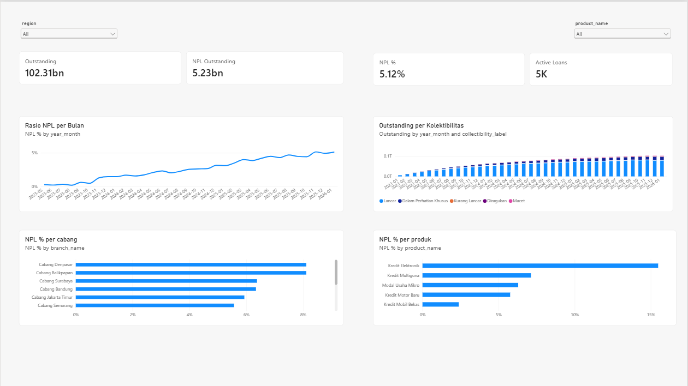
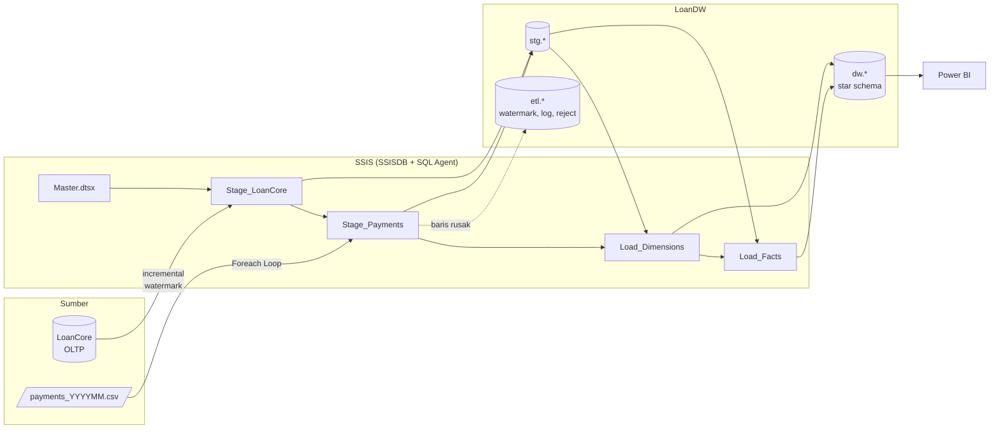
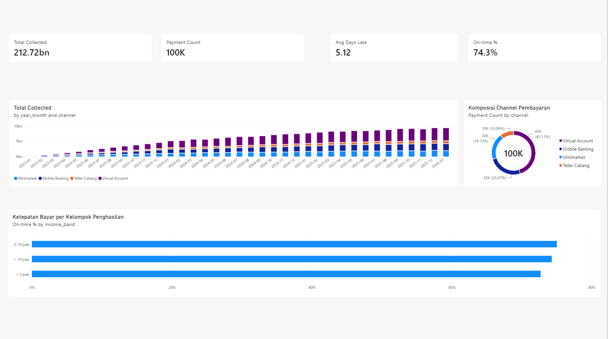

# Loan Data Warehouse (SQL Server + SSIS)

Data warehouse untuk portofolio pinjaman sebuah perusahaan pembiayaan (multifinance) fiktif di Indonesia. Data diambil dari database operasional dan file pembayaran harian, lalu dimuat ke star schema di SQL Server menggunakan SSIS. Hasilnya dipakai untuk memantau kualitas kredit sesuai kolektibilitas OJK dan rasio NPL.



## Ringkasan

- **Sumber:** database OLTP `LoanCore` (cabang, produk, nasabah, pinjaman) dan 37 file CSV pembayaran bulanan dari payment gateway.
- **ETL:** 5 package SSIS, diorkestrasi oleh `Master.dtsx`, di-deploy ke katalog SSISDB, dan dijadwalkan dengan SQL Server Agent setiap hari pukul 02:00.
- **Warehouse:** `LoanDW` dengan skema `stg` (staging), `etl` (kontrol dan log), dan `dw` (star schema).
- **Hasil:** 8.000 pinjaman, 100.395 pembayaran, dan 112.967 baris snapshot bulanan. NPL Januari 2026 sebesar 5,12%.

## Arsitektur



## Tech stack

| Bagian | Tools |
|---|---|
| Database | SQL Server 2025 Developer, T-SQL |
| ETL dan orkestrasi | SSIS (Visual Studio 2026), katalog SSISDB, SQL Server Agent |
| Data generator | Python 3 (standard library saja) |
| Dashboard | Power BI Desktop, DAX |

## Data

Semua data adalah data sintetis dari [scripts/generate_data.py](scripts/generate_data.py) (seed tetap = 42, jadi hasilnya selalu sama).

- 5.000 nasabah, 8.000 pinjaman, 12 cabang, dan 5 produk: Kredit Motor Baru, Kredit Mobil Bekas, Kredit Multiguna, Kredit Elektronik, dan Modal Usaha Mikro.
- Bunga flat, tenor dalam bulan, dan cicilan bulanan.
- Setiap nasabah punya profil risiko tersembunyi (lancar, sering telat, atau macet) yang menentukan pola pembayarannya.
- **Data kotor yang sengaja disisipkan** ke file CSV untuk menguji penanganan error di ETL:
  - nominal berformat teks (`Rp1.819.200`)
  - tanggal tidak valid (`2023-05-32`)
  - `loan_id` yang tidak ada di sistem
  - `payment_id` duplikat

## Model data

Star schema di skema `dw`:

| Tabel | Grain | Catatan |
|---|---|---|
| `dim_date` | 1 baris per hari (2022–2030) | Nama bulan dan hari dalam Bahasa Indonesia |
| `dim_branch` | 1 baris per cabang | SCD Type 1 |
| `dim_product` | 1 baris per produk | SCD Type 1 |
| `dim_customer` | 1 baris per versi nasabah | **SCD Type 2**: pekerjaan, penghasilan, kota, dan provinsi dilacak historinya |
| `fact_loan` | 1 baris per pinjaman | Pokok, bunga, cicilan, tanggal cair, dan jatuh tempo |
| `fact_payment` | 1 baris per pembayaran | Jatuh tempo cicilan dan `days_late` |
| `fact_loan_monthly_snapshot` | 1 baris per pinjaman aktif per akhir bulan | Outstanding, DPD, kolektibilitas OJK, dan flag NPL |

Setiap dimensi punya baris **unknown member** (key `-1`), sehingga fakta yang tidak menemukan pasangan dimensinya tidak hilang.

**Kolektibilitas OJK** dihitung dari days past due (DPD):

| DPD | Kolektibilitas | NPL |
|---|---|---|
| 0 | 1 – Lancar | |
| 1–90 | 2 – Dalam Perhatian Khusus | |
| 91–120 | 3 – Kurang Lancar | ✔ |
| 121–180 | 4 – Diragukan | ✔ |
| > 180 | 5 – Macet | ✔ |

## Package SSIS

| Package | Isi |
|---|---|
| `Stage_LoanCore` | Membaca watermark dari `etl.watermark`, lalu menarik hanya baris yang `updated_at`-nya lebih baru (incremental) dari 4 tabel sumber ke `stg.*` |
| `Stage_Payments` | **Foreach Loop** atas `data/incoming/payments_*.csv`. File yang sudah tercatat di `etl.file_log` dilewati. **Data Conversion** dengan error output: baris yang gagal dikonversi masuk ke `etl.payment_reject`, bukan menggagalkan run. Setelah dimuat, file dicatat dan dipindah ke `data/archive` |
| `Load_Dimensions` | Memanggil stored procedure MERGE untuk SCD1 (cabang, produk) dan SCD2 (nasabah) |
| `Load_Facts` | MERGE `fact_loan`. Data Flow pembayaran memakai **Lookup** ke pinjaman (no match → reject "Unknown loan_id") dan **range Lookup** ke `dim_customer` untuk mengambil versi nasabah yang berlaku pada tanggal bayar. Terakhir, membangun ulang snapshot bulanan |
| `Master` | Membuka batch di `etl.batch_run`, menjalankan keempat package dengan `BatchId` sebagai parameter, lalu menutup batch. Event handler **OnError** mencatat status FAILED beserta pesan error-nya |



## Keputusan desain

- **Incremental dengan watermark.** Hanya baris yang berubah yang ditarik dari sumber. Run kedua tanpa perubahan menarik 0 baris.
- **Idempoten.** Pipeline aman dijalankan berulang kali:
  - file yang sudah diproses dilewati (`etl.file_log`)
  - `fact_payment` punya `payment_id` UNIQUE, dan view sumbernya membuang pembayaran yang sudah dimuat
  - snapshot dibangun ulang penuh setiap run
- **Data kotor tidak menggagalkan run.** Baris bermasalah dipisahkan ke `etl.payment_reject` beserta alasannya dan `batch_id`-nya, sehingga bisa ditindaklanjuti.
- **SCD2 dengan point-in-time lookup.** Laporan historis tetap memakai profil nasabah pada saat transaksi terjadi, bukan profil terbaru.
- **Logika bisnis di stored procedure, alur di SSIS.** T-SQL lebih mudah dites dan di-review. SSIS mengatur urutan, file, konversi tipe, lookup, dan penanganan error.
- **`READ_COMMITTED_SNAPSHOT` di LoanDW.** Lihat bagian Troubleshooting.

## Hasil

Dua run end-to-end (data awal sampai Desember 2025, lalu run incremental Januari 2026):

| | Run awal | Setelah run Januari |
|---|---|---|
| File diproses | 36 | 37 |
| Baris dibaca dari CSV | 96.357 | 100.797 |
| `fact_payment` | 95.977 | 100.395 |
| `fact_loan` | 7.791 | 8.000 |
| `dim_customer` (current) | 4.996 | 5.300 (5.000) |
| Snapshot bulanan | 108.037 | 112.967 |
| Reject konversi / duplikat / unknown loan | 196 / 85 / 99 | 209 / 89 / 104 |

Setiap baris CSV bisa ditelusuri asalnya: total baris dibaca sama dengan baris di fact ditambah semua reject. Jumlah reject juga sama persis dengan jumlah data kotor yang disisipkan generator.

Pada run Januari, 300 nasabah yang datanya berubah mendapat versi SCD2 baru. Pembayaran Januari otomatis tertaut ke versi baru itu, sedangkan pembayaran lama tetap menunjuk ke versi lama. Pengecekan overlap rentang tanggal menghasilkan 0.

**Insight dari dashboard:**
- NPL naik bertahap dari sekitar 0% di 2023 menjadi 5,12% di Januari 2026, seiring portofolio yang makin matang.
- **Kredit Elektronik** punya NPL tertinggi (~15%), sekitar dua kali lipat produk lain.
- **Cabang Denpasar dan Balikpapan** punya NPL tertinggi (~8%).
- 74,3% pembayaran tepat waktu. Virtual Account adalah channel terbesar (45%).

## Cara menjalankan

Prasyarat: SQL Server 2025 (edisi Developer, gratis) dengan Integration Services, Visual Studio dengan ekstensi SQL Server Integration Services Projects, dan Python 3.

```bash
# 1. Generate data
python scripts/generate_data.py

# 2. Buat database sumber dan warehouse
sqlcmd -S localhost -E -C -i sql/01_create_loancore.sql
sqlcmd -S localhost -E -C -i source/loancore_seed.sql
sqlcmd -S localhost -E -C -i sql/02_create_loandw.sql
sqlcmd -S localhost -E -C -i sql/03_etl_procedures.sql
```

3. Buka `ssis/LoanDW_ETL/LoanDW_ETL.slnx` di Visual Studio, lalu jalankan `Master.dtsx` (F5).
4. Deploy ke katalog:
   - Di SSMS: Integration Services Catalogs → Create Catalog, lalu buat folder `LoanDW`.
   - Di Visual Studio: klik kanan project → Deploy.
5. Buat jadwal harian:

```bash
sqlcmd -S localhost -E -C -i sql/04_create_agent_job.sql
```

6. Untuk demo run incremental bulan Januari:

```bash
sqlcmd -S localhost -E -C -i source/loancore_changes.sql
```

```bash
cp data/next_month/payments_202601.csv data/incoming/
```

   Lalu jalankan job `LoanDW - Daily ETL` atau `Master.dtsx` lagi.

7. Buka `powerbi/Loan_Portfolio_Dashboard.pbix` di Power BI Desktop dan klik Refresh. Semua rumus DAX ada di [powerbi/measures.dax](powerbi/measures.dax).

## Troubleshooting

**Data Flow `Load_Facts` macet (self-blocking).** Source membaca `vw_payment_to_load`, yang mengecek `NOT EXISTS` ke `dw.fact_payment`. Pada saat yang sama, destination melakukan fast load dengan table lock ke tabel yang sama. Destination menunggu lock, sementara source menunggu buffer dikosongkan, sehingga keduanya saling menunggu tanpa terdeteksi sebagai deadlock oleh SQL Server. Solusinya mengaktifkan `READ_COMMITTED_SNAPSHOT` di LoanDW, supaya pembaca memakai row versioning dan tidak memasang shared lock.

**Deploy ke SSISDB gagal dengan `LCID 14345 is not supported`.** Kode .NET di dalam SQL Server memakai locale akun service `NT Service\MSSQLSERVER`, yaitu `en-ID`, yang tidak didukung SQL Server. Solusinya mengubah locale akun service tersebut ke `en-US` di registry (`HKEY_USERS\<SID service>\Control Panel\International`), lalu me-restart SQL Server.

## Struktur folder

```
loan-data-warehouse/
├── scripts/generate_data.py     generator data sintetis
├── sql/
│   ├── 01_create_loancore.sql   database sumber (OLTP)
│   ├── 02_create_loandw.sql     staging, tabel kontrol ETL, star schema
│   ├── 03_etl_procedures.sql    stored procedure SCD, fact, snapshot
│   └── 04_create_agent_job.sql  job SQL Agent harian
├── ssis/LoanDW_ETL/             project SSIS (5 package)
├── powerbi/                     dashboard dan rumus DAX
├── docs/                        screenshot dashboard
└── data/                        incoming, archive, next_month (dibuat oleh generator)
```
